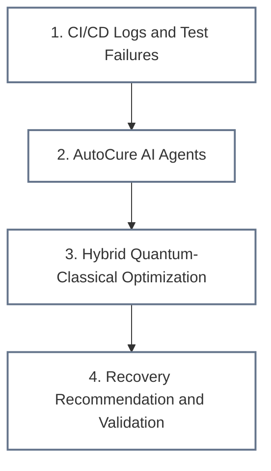

# Cosmo Nibblers

**VTU-QFF-HC-0196** | Tier: **Online**

---

## 🎬 Project Demo & Presentation

| Resource | Link |
| :--- | :--- |
| **YouTube Demo Video** | https://www.youtube.com/watch?v=QN0nZD9dp1Q |
| **Project Presentation (PPT)** | https://drive.google.com/drive/folders/11CyxtFrB8QtD_HJMMspRLl3vRipkxZwM?usp=sharing |


---

| | |
| :--- | :--- |
| **Team** | Cosmo Nibblers |
| **Team ID** | VTU-QFF-HC-0196 |
| **Tier** | Online |
| **Repository** | [vtu-hc-cosmo-nibblers](https://github.com/vtu-qiskit-fall-fest-2026/vtu-hc-cosmo-nibblers.git) |
| **Organisation** | [vtu-qiskit-fall-fest-2026](https://github.com/vtu-qiskit-fall-fest-2026) |
| **Event** | VTU-QFF Hackathon — VTU-Qiskit Fall Fest 2026 |

---

## 📌 Table of Contents

- [Team Members](#-team-members-github-ids)
- [Track / Domain](#-track--domain)
- [Problem Statement](#-problem-statement)
- [Proposed Solution](#-proposed-solution)
- [Approach & Architecture](#-approach--architecture)
- [Tech Stack](#-tech-stack)
- [Project Structure](#-project-structure)
- [How to Run](#-how-to-run)
- [How to Push Code](#-how-to-push-code)
- [Submission Checklist](#-submission-checklist)
- [Resources](#-resources)
- [License](#-license)

---

## 👥 Team Members (GitHub IDs)

| # | Name | GitHub Username | Role |
| :-- | :--- | :--- | :--- |
| 1 | *Utkarsh Kumar* | [ukg1911](https://github.com/ukg1911) | *Team Lead* |
| 2 | *Sumit Raj* | [Sumits-Cosmos](https://github.com/Sumits-Cosmos) | *Developer* |
| 3 | *Aaditya Raj* | [aadityaraj11](https://github.com/aadityaraj11) | *Developer* |

<!--
Optional: add a plain list instead of the table above.
- @username1
- @username2
-->

---

## ⚛️ Track / Domain

**Domain 4: Quantum + AI & ML**

**Project Title:** Q-AutoCure: Hybrid Quantum-AI for Self-Healing DevOps Pipelines

---

## ❓ Problem Statement

Modern CI/CD pipelines frequently experience build, testing, deployment, and security failures that require substantial manual effort to diagnose and resolve. Conventional AI-based approaches can identify likely root causes and suggest fixes, but selecting the most appropriate recovery action from multiple candidates remains challenging.

This project explores how quantum-assisted optimization, combined with AI-driven failure analysis, could help prioritize candidate recovery actions in autonomous DevOps workflows.

---

## 💡 Proposed Solution

**Solution:** Q-AutoCure extends the existing AutoCure autonomous DevOps healing platform with an experimental hybrid quantum-classical optimization module. The existing AI agents analyze pipeline failures and generate candidate recovery actions, while a quantum-assisted optimization approach will be explored to rank these candidates. The system will be evaluated against a classical baseline to measure its effectiveness.

**Key idea:** Combine AI-driven failure analysis and automated DevOps recovery with quantum-assisted optimization of candidate repair actions.

**Why this works:** The project explores how quantum computing and AI/ML could work together to support intelligent failure recovery, reduce manual debugging effort, and systematically evaluate candidate fixes.

**Evaluation goal:** Compare the quantum-assisted approach with a classical baseline using measurable criteria such as solution quality, ranking effectiveness, and execution time. No quantum advantage is assumed in advance.

---

## 🧩 Approach & Architecture

The following diagram represents the **proposed workflow**. The quantum optimization component is experimental and should be identified as implemented only after it is integrated and tested.



1. **CI/CD logs and test failures** — Ingests build output, test traces, and pipeline failure information.
2. **AutoCure AI agents** — Analyzes failures, identifies likely root causes, and generates candidate fixes.
3. **Hybrid optimization layer** — Explores Qiskit-based quantum-assisted optimization alongside a classical baseline to rank candidate remediation actions.
4. **Recovery recommendation and validation** — Presents ranked actions and validation results through the existing dashboard and recovery workflow.

---

## 🛠️ Tech Stack

| Layer | Technology |
| :--- | :--- |
| Programming languages | Python, JavaScript / TypeScript, as used in the existing codebase |
| Frontend | React |
| Backend and API | FastAPI and existing backend services |
| AI / ML | Existing AutoCure failure analysis and AI-agent components |
| Quantum SDK | Qiskit and Qiskit Aer for the planned quantum experiment |
| Optimization | Classical baseline and a suitable Qiskit-compatible optimization approach |
| Testing | Existing project tests; additional tests for the quantum optimization module |
| Environment | VS Code, Python virtual environment, Node.js |
| Version control | Git and GitHub |
| Deployment / orchestration | Existing Docker configuration, where applicable |


---

## 📁 Project Structure

The following structure describes the existing AutoCure application and the planned quantum extension. The quantum-service directory and its files should be added only when they have been created.

```text
vtu-hc-cosmo-nibblers/
├── README.md
├── frontend/                  # Existing React dashboard
├── backend/                   # Existing backend services
├── python-service/            # Existing AI / Python services
│   └── src/
│       └── agents/
│           └── failure_classifier.py
├── quantum-service/           # Planned quantum experiment
│   ├── optimizer.py           # Candidate optimization
│   └── main.py                # Experiment entry point
├── tests/                     # Existing and additional tests
├── docker-compose.yml         # Existing container configuration
├── requirements.txt           # Python dependencies, if maintained here
├── .gitignore
└── LICENSE
```


---

## 🚀 How to Run

### Prerequisites

- Git
- Python version supported by the existing project
- Node.js version supported by the frontend
- Access to any required AI API keys or environment variables
- Qiskit and Qiskit Aer when running the quantum experiment

### 1. Clone the repository

```bash
git clone https://github.com/vtu-qiskit-fall-fest-2026/vtu-hc-cosmo-nibblers.git
cd vtu-hc-cosmo-nibblers
```

### 2. Set up the Python environment

```bash
python -m venv .venv
```

Windows PowerShell:

```powershell
.venv\Scripts\Activate.ps1
```

Linux / macOS:

```bash
source .venv/bin/activate
```

### 3. Install dependencies

Install dependencies using the files provided by the relevant existing service. For example:

```bash
pip install -r python-service/requirements.txt
```

> Use this command only if that requirements file exists. Install the frontend dependencies from the frontend's own package file and install quantum dependencies from the appropriate requirements file when the quantum module is added.

### 4. Start the application

Use the existing project instructions and scripts, such as the provided Docker Compose configuration or startup script, after checking their current contents.

Do not use `python -m src.main` unless that entry point actually exists in the repository.

### 5. Run tests

Run the test commands defined by the relevant project components. For Python tests, a common command is:

```bash
pytest -q
```

Use it once the test dependencies are installed and the test suite is configured.

---

## 🔁 How to Push Code

> Full walkthrough: **[Git & Collaboration Handbook](../vtu-hc-guide-git-and-collaboration)** — collaboration workflow, branches, pull requests, reviews and conflict resolution.

### Configure Git (first time only)

```bash
git config --global user.name "Your Name"
git config --global user.email "you@example.com"
```

### Everyday workflow

```bash
# 1. Get the latest changes
git checkout main
git pull origin main

# 2. Create a branch for your work
git checkout -b feature/my-task

# 3. Commit your work
git add .
git commit -m "feat: add quantum-assisted optimization"

# 4. Push the branch
git push -u origin feature/my-task

# 5. Open a Pull Request on GitHub and request a review
# https://github.com/vtu-qiskit-fall-fest-2026/vtu-hc-cosmo-nibblers/compare/main...feature/my-task

# 6. After approval, merge through the authorized workflow
git checkout main
git pull origin main
git branch -d feature/my-task
```

### Commit message convention

| Prefix | Meaning |
| :--- | :--- |
| `feat:` | New feature |
| `fix:` | Bug fix |
| `docs:` | Documentation only |
| `test:` | Adding or fixing tests |
| `refactor:` | Code restructure, no behaviour change |
| `chore:` | Build/config/dependency changes |

### Useful commands

```bash
git status              # what changed
git log --oneline -10   # recent commits
git diff                # review changes before committing
git stash               # shelve changes temporarily
git pull --rebase       # update your branch on top of main
```

### Collaborating on the same repo

- **Never push directly to `main`** — open a Pull Request.
- **Pull before you push** to avoid rejected commits.
- **Commit often** with clear messages.
- **Resolve conflicts** locally and review the result before continuing.
- **Ask for a review** before merging — a second pair of eyes catches bugs fast.


---

## 📚 Resources

| Resource | Link |
| :--- | :--- |
| 🔁 Git & collaboration handbook | [Git & Collaboration Handbook](../vtu-hc-guide-git-and-collaboration) |
| ❓ Problem statements, solutions & terms | [Problem Statements, Solutions & Terms](../vtu-hc-guide-problem-and-solution) |
| 📄 README writing guide | [README Guide & Template](../vtu-hc-guide-readme-template) |
| ⚛️ Qiskit documentation | [Qiskit Docs](https://docs.quantum.ibm.com/) |
| ⚛️ Qiskit Runtime & primitives | [IBM Quantum Documentation](https://quantum.cloud.ibm.com/docs/) |
| 🧪 Qiskit Aer simulator | [Qiskit Aer Guide](https://docs.quantum.ibm.com/guides/simulators) |
| 💻 IBM Quantum Platform | [IBM Quantum](https://quantum.cloud.ibm.com/) |
| 🎓 Qiskit textbook | [Qiskit Learning](https://qiskit.qotlabs.org/learning/) |
| 📋 GitHub Docs | [GitHub Documentation](https://docs.github.com/) |

---

## 📄 License

Released under the [MIT License](LICENSE). See `LICENSE` for details.

---

<div align="center">

**Cosmo Nibblers** · Team ID `VTU-QFF-HC-0196` · Tier `Online`

Built with ⚛️ Qiskit for the VTU-QFF Hackathon

[⬆ Back to Top](#cosmo-nibblers)

</div>
